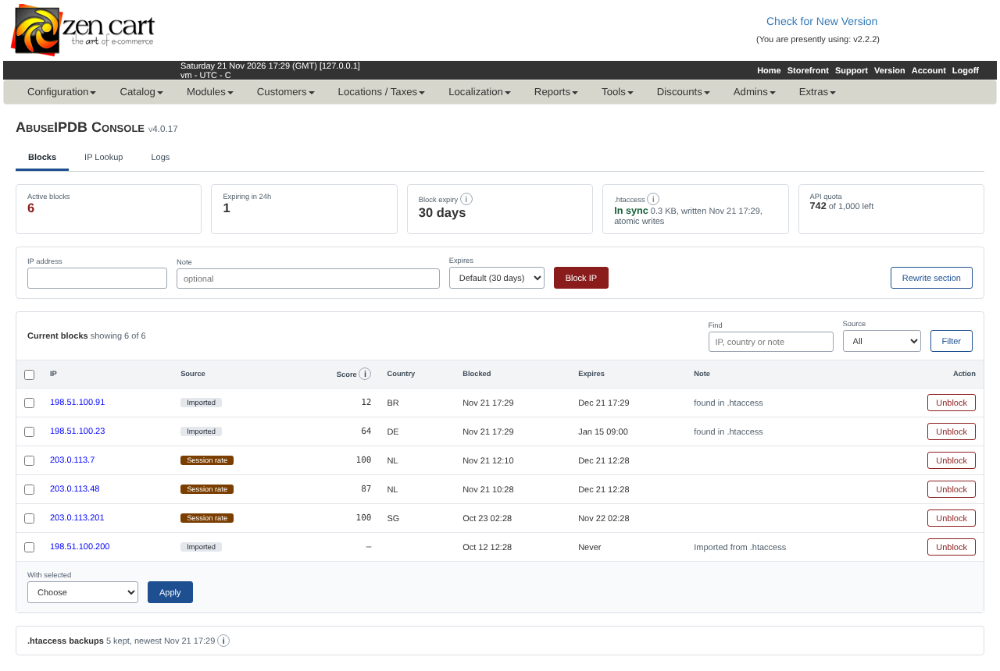
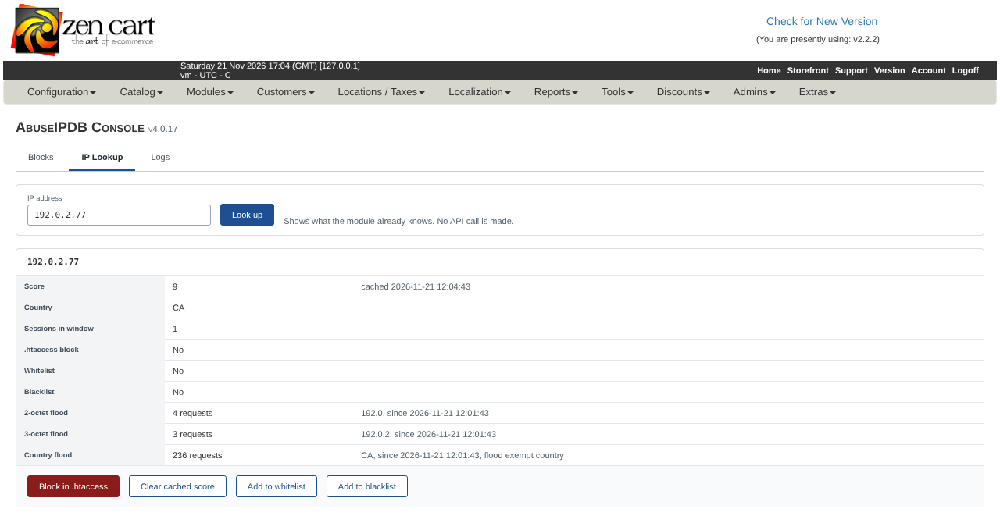
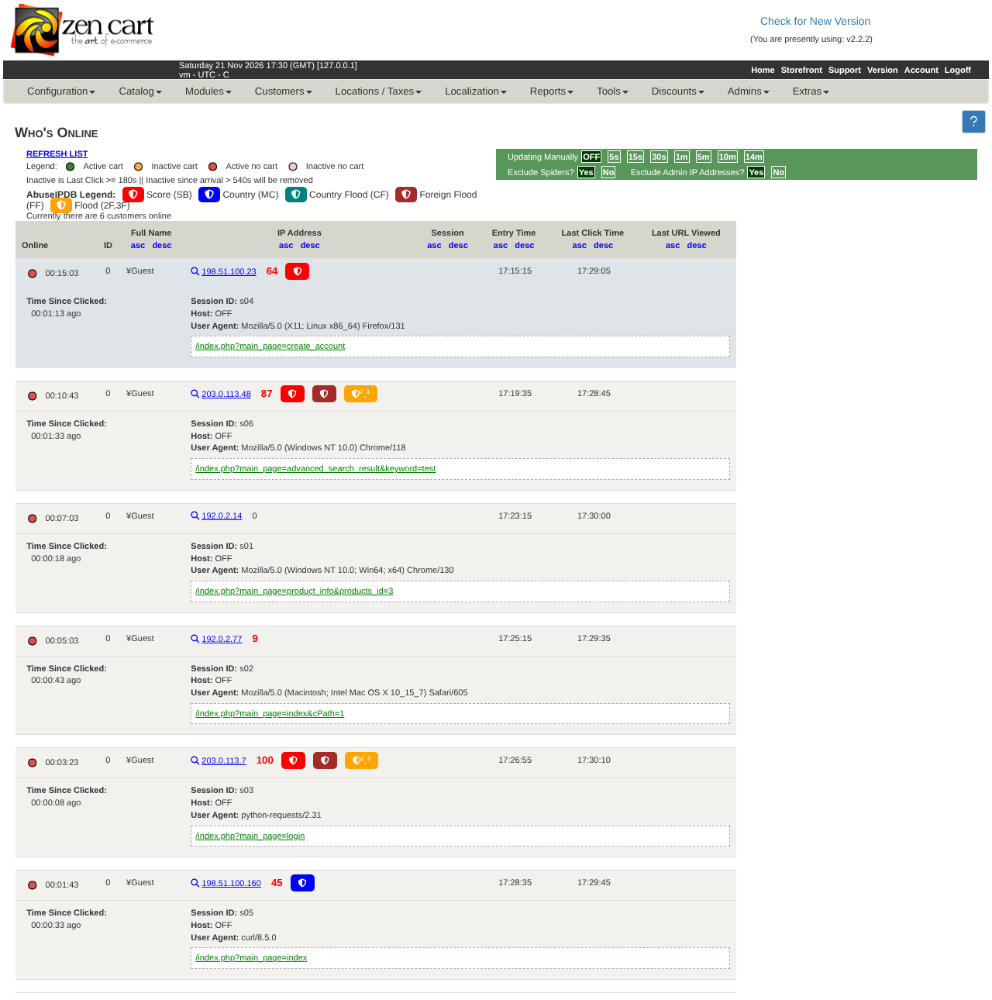

# AbuseIPDB for Zen Cart


[](https://github.com/CcMarc/AbuseIPDB/blob/main/CHANGELOG.md) [](https://www.php.net/)
[](https://www.zen-cart.com/)
[](LICENSE.md)
[](https://github.com/CcMarc/AbuseIPDB/commits/main)
[](https://github.com/CcMarc/AbuseIPDB/releases/latest)

Protects a Zen Cart store from abusive IP addresses. Each visitor's IP is
checked against the [AbuseIPDB](https://www.abuseipdb.com) confidence score
and blocked when the score passes your threshold.

Around that sit the tools a busy store needs: a cache that keeps API calls
low, flood protection by IP range and by country, manual whitelists and
blacklists, country blocking, and session rate limiting that writes
blocks to `.htaccess`. Everything is managed from the admin.

## How it presents

- **Configuration > AbuseIPDB Settings**: every setting, with the installed
  version and a count of settings so you can see nothing is missing.
- **Tools > AbuseIPDB Console**: the IPs blocked in `.htaccess`, an IP
  lookup, and the module's logs.
- **Who's Online**: the AbuseIPDB score beside each visitor, a colored
  shield when the visitor is blocked, and a legend for the shields.
- **Admin home**: an optional widget with your AbuseIPDB contributor badge
  and recent session blocks.
- **Storefront**: nothing changes for normal visitors. A blocked visitor
  gets a 403 or your Page Not Found page.







## Requirements

- Zen Cart 2.2.2 or later
- PHP 8.0 or later (PHP 8.5 recommended)
- Apache 2.4 for session blocking in `.htaccess` (`Require not ip`)
- A free [AbuseIPDB](https://www.abuseipdb.com) account and API key

## Install

As with any plugin, install on a development or staging copy of your store
first.

1. Upload the `zc_plugins/AbuseIPDB/` folder into your store's
   `zc_plugins/` directory.
2. Admin > Modules > Plugin Manager > AbuseIPDB > Install.
3. Open Configuration > AbuseIPDB Settings, enter your API key and set
   **Enable AbuseIPDB?** to true.

The installer creates the settings, its tables and `includes/blacklist.txt`
(an existing file is kept). The Who's Online integration is automatic. No
core file is uploaded or changed.

## Upgrade

Upload the new version folder beside the installed one and use **Upgrade**
in Plugin Manager. Settings, cached scores and blocks are kept.

| From | What to know |
| ---- | ------------ |
| v4.0.16 | One new setting, `Additional Home Country Codes`, empty by default. Nothing changes until you fill it in |
| v4.0.15 | If you plan to uninstall the plugin, upgrade first so the corrected uninstaller is the one that runs |
| v4.0.14 | The AbuseIPDB Console is added under Tools. Existing `.htaccess` session blocks are imported and show as "Imported". Blocks now expire after 30 days by default, counted from the day you upgrade. Set `Session Block Expiry (days)` to 0 to keep the old behavior |
| v4.0.12 or v4.0.13 | No action needed |
| v4.0.9 or earlier | `whos_online.php` no longer needs to be uploaded, so a customized copy can go back to the stock file. `.htaccess` session blocks are converted to Apache 2.4 syntax, with a backup made first |
| Below v3.0.0 | Earlier versions were not encapsulated plugins. Their files are removed automatically when this version is installed |

## Setup

### API key

1. Sign up at [AbuseIPDB](https://www.abuseipdb.com) and create an API key
   in your account.
2. Paste it into **AbuseIPDB: API Key** in the settings.
3. [Verify your domain](https://www.abuseipdb.com/account/webmasters) in
   the AbuseIPDB Webmasters section. This raises the free daily limit from
   1,000 checks to 3,000.

### Contributor badge widget (optional)

Showing the AbuseIPDB contributor badge on your admin home page can raise
the daily limit to 5,000.

1. Open the [Contributors Badge](https://www.abuseipdb.com/account/contributor)
   page in your AbuseIPDB account. In the HTML block shown there, find the
   link `https://www.abuseipdb.com/user/XXXXXX`. The number is your member
   ID. It is not your API key.
2. Enter that number in **AbuseIPDB: User ID**.
3. Set **Enable Admin Widget?** to true.

Setting it back to false removes the widget and may lose the higher limit.

## Features

### Score blocking and cache

- A visitor is blocked when the AbuseIPDB score is at or above your
  threshold.
- Scores are cached in the database so an IP is looked up once per cache
  period. High scoring IPs can be cached for longer.
- Old cache records are removed once a day when IP Cleanup is enabled.
- Test mode logs chosen IPs as blocked whatever their score, for checking
  your setup.

### Whitelist and blacklist

- Whitelisted IPs skip every check. Blacklisted IPs are blocked at once.
  Enter them comma separated with no spaces, for example
  `192.168.1.1,192.168.2.2`.
- **Enable IP Blacklist File?** adds a file with one full or partial IP per
  line. A match is blocked before any other check.

### Flood protection

Hits are counted by 2-octet prefix (`192.168`), by 3-octet prefix
(`192.168.1`) and by country code.

- **2-octet and 3-octet flood**: blocks a range when its count passes the
  threshold.
- **Country flood**: when one country passes the threshold, visitors from
  it are blocked if their score is at or above
  `Country Flood Minimum Score` (default 5).
- **Foreign flood**: the same check with its own lower threshold and
  minimum score, for every country that is not a home country.
- **Home countries**: `Default Country Code` is your home country.
  `Additional Home Country Codes` adds more, for example `CA,GB`, for a
  store that sells in several countries. They are treated exactly like
  your default country: foreign flood skips them, and country flood
  applies to them as it does to your default country.
- **Score safe**: country and foreign flood only block an IP that also
  meets the minimum score, so a sale or a newsletter does not lock out
  real customers.
- **Counters reset** when no new visitor from that prefix or country has
  been counted for the reset time.

### Manual country blocking

`Manually Blocked Country Codes` blocks whole countries at once, for
example `VN,CN,RU`.

### Session rate limiting

Stops bots that open sessions very quickly.

- An IP that creates more sessions than the threshold in the time window
  (default 100 in 60 seconds) is queued and then written to its own
  section of `.htaccess`.
- Blocks expire on their own (default 30 days). No cron job is needed.
- Requires Apache 2.4. On other servers use the server's own rate
  limiting.
- `.htaccess` and its folder must be writable by the web server user:

  ```bash
  chmod 664 /path/to/zen-cart/.htaccess
  chmod 775 /path/to/zen-cart
  ```

- The section looks like this and is created on the first block:

  ```
  <RequireAll>
  # AbuseIPDB Session Blocks Start
  Require not ip <IP>
  # AbuseIPDB Session Blocks End
  </RequireAll>
  ```

- Set **Write Session Blocks to .htaccess?** to false to stop the module
  from touching the file. Blocks are still recorded and shown in the
  console.

### AbuseIPDB Console

Under Tools > AbuseIPDB Console.

- **Blocks**: every IP blocked in `.htaccess` on one line, with its source
  (Session rate, Manual or Imported), cached score, country, when it was
  blocked, when it expires and a note. Block an IP by hand, unblock one or
  many, change expiry, or unblock and whitelist in one step.
- **Status tiles**: active blocks, blocks expiring in 24 hours, the expiry
  setting, whether `.htaccess` matches the block list, and your remaining
  API quota.
- **Backups**: a copy of `.htaccess` is saved before every change. The
  five newest are kept and any of them can be restored.
- **IP Lookup**: what the module already knows about an IP, including its
  score, country, block status and flood counters. No API call is made.
- **Logs**: the module's log files, newest lines first.

Safeguards:

- Whitelisted IPs are never written to `.htaccess`.
- The console refuses to block the address you are logged in from.
- Every write is locked and checked. If the check fails the previous file
  is put back and the error is logged.
- Lines you add to the section yourself that are not single IP entries,
  such as comments or `Require not ip 203.0.113.0/24`, are left untouched.
  A single IP line you add is picked up as "Imported".

### Who's Online

- The AbuseIPDB score is shown beside each visitor. Click it to open the
  IP on AbuseIPDB.
- A shield shows why a visitor is blocked:

  | Shield | Meaning |
  | ------ | ------- |
  | Red | Score block (SB) |
  | Purple | IP blacklist (IB) |
  | Blue | Manual country block (MC) |
  | Teal | Country flood (CF) |
  | Brown | Foreign flood (FF) |
  | Orange | 2-octet or 3-octet flood (2F, 3F) |

- A grey button beside an unblocked visitor with a score above 0 adds that
  IP to the blacklist file. It needs **Enable IP Blacklist File?** set to
  true.
- The legend shows only the shields for features you have enabled.

### Spiders

With **Allow Spiders?** enabled, known search engine spiders skip the IP
check, which saves API calls. Spiders are recognized with Zen Cart's own
`spiders.txt`.

### Logging

- Blocked IPs, API calls and spiders can each be logged. The folder is set
  in `Log File Path`.
- Session rate limit blocks are always logged to
  `abuseipdb_session_blocks.log`, and every `.htaccess` change to
  `abuseipdb_htaccess_YYYY_MM.log`.
- The log folder must be writable by the web server user. If you also
  manage the files over SFTP, give the folder a group both users share and
  mode `2775`, so new log files inherit the group.

### API limits and other integrations

- When the AbuseIPDB quota runs out, lookups fail safely. An IP without a
  score is treated as neutral and is never blocked by flood or country
  rules.
- After every API call the module records the quota AbuseIPDB reported.
  It is shown on the settings page and in the console, and costs no extra
  API calls.
- **Trust Cloudflare?** reads the real visitor IP from the
  `CF-Connecting-IP` header when your store is behind Cloudflare.
- **Defer to External Triage** lets a compatible companion plugin decide
  about a request before an API call is spent on it.

## How a request is checked

1. A whitelisted IP is let through.
2. Session rate limiting counts the session and queues the IP for an
   `.htaccess` block when it passes the threshold.
3. A blacklisted IP is blocked.
4. The score is read from the cache, or from the AbuseIPDB API when the
   cache has no current record. Known spiders skip this when allowed.
5. Flood counters are updated. Then the 2-octet and 3-octet floods,
   country flood, foreign flood and manual country blocks are checked.
6. An IP whose score is at or above the threshold is blocked.
7. Anything else is treated as safe.

## Compatibility

| Zen Cart | Status |
| -------- | ------ |
| 2.2.2 | Developed and tested, including live production use |
| 2.2.0 and 2.2.1 | Not tested |
| 2.1.x and earlier | Not supported |

## Translations

All admin text lives in language files. English is in
`zc_plugins/AbuseIPDB/v4.0.18/admin/includes/languages/english/extra_definitions/`:

- `lang.abuseipdb_admin.php`: the console, the Who's Online shields and
  legend, the dashboard widget and the settings page helpers.
- `lang.abuseipdb_admin_names.php`: the menu entries.

The title and description of every setting, the settings group and the
Plugin Manager name and description are stored in the database in English.
A translation overrides them from its own `lang.menu.php`.

French and Japanese are included, translated by
[piloujp](https://github.com/piloujp).

To add a language, copy the three files from the `french` folder to the
matching folder for your language, for example
`admin/includes/languages/german/extra_definitions/`, and translate the
values. The keys stay as they are. Strings that build sentences are sprintf
templates, so word order is yours. Anything you leave out falls back to
English.

Log files are written in English.

Contributed language files are welcome. Open a pull request and they will
ship with the plugin, credited here and in the files themselves.

## Contributors

- [@piloujp](https://github.com/piloujp): the initial upgrade logic for
  v4.0.1, including table and column validation
- [@retched](https://github.com/retched): the verification badge in the
  admin area in v2.1.2

## Support

This plugin is provided as is, on a best effort basis. There is no
guaranteed support or response time.

- Questions and general help: the
  [Zen Cart support thread](https://www.zen-cart.com/showthread.php?229438-AbuseIPDB-Integration-module)
  or [GitHub issues](https://github.com/CcMarc/AbuseIPDB/issues).

## Disclaimer

Provided as is, without warranty of any kind, under the GPL. This plugin
blocks visitors, so test your settings on a development or staging copy
before a live store, and whitelist your own IP first. You are responsible
for your own store, its data and its backups.

## License

GNU General Public License (GPL), see [LICENSE.md](LICENSE.md).
